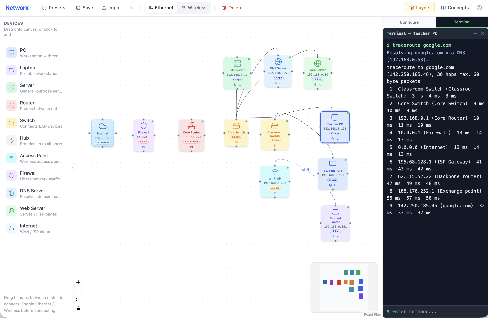

# Networx

A browser-based network emulator for teaching computer networking concepts at GCSE and A Level (OCR specifications J277 and H446).

**[Live demo →](https://milesberry.net/networx)**



## What it does

Networx lets you build virtual networks by dragging hardware components onto a canvas and connecting them with wired or wireless links. Once built, you can:

- **Run terminal commands** on PCs, laptops, and servers — `ping`, `traceroute`, `ipconfig`, `nslookup`, `curl`, `ssh`, and more
- **Browse the web** — a built-in browser on PC/Laptop/Server nodes renders pages served by Web Server nodes, resolves hostnames via local DNS, and simulates internet access through a Cloud node
- **SSH between nodes** — `ssh <ip>` opens a persistent session; all subsequent commands run as the remote device until you type `exit`
- **Assign IPs with DHCP** — routers run a DHCP server; clients request leases with `dhclient` (Linux) or `ipconfig /renew` (Windows), animating the full four-way handshake
- **Configure DNS records** — DNS Server nodes hold A records that resolve hostnames across the network
- **Ping domain names** — `ping google.com` resolves via DNS and routes through the internet node
- **Inspect switch MAC tables** — tables populate as traffic flows, showing which MAC address was learned on which port
- **Configure routers** — add static routing table entries
- **Set firewall rules** — allow/deny by protocol, port, and IP
- **Configure wireless access points** — SSID, WPA key, 2.4/5 GHz band
- **Load preset scenarios** — five built-in topologies covering key exam topics
- **Save and share** — export your network as a `.json` file and import it elsewhere

## Preset scenarios

| Scenario | Covers |
|---|---|
| Star Topology (LAN) | Switch MAC tables, LAN addressing, ping |
| Home Network | NAT, router, WAP, wired + wireless clients |
| School Network | Firewall rules, network segmentation, servers |
| Client-Server Model | DNS resolution, HTTP, `nslookup`, `curl` |
| Mesh / WAN Topology | Redundant paths, inter-site routing, internet backbone |

## Curriculum links

- **OCR GCSE Computer Science J277** — Networks (1.3): protocols, hardware, topologies, internet, security
- **OCR A Level Computer Science H446** — Communication and networking (1.3): IP, TCP/IP stack, packet switching, hardware, client-server

Spec links:
- [GCSE J277](https://www.ocr.org.uk/Images/558027-specification-gcse-computer-science-j277.pdf)
- [A Level H446](https://www.ocr.org.uk/images/170844-specification-accredited-a-level-gce-computer-science-h446.pdf)

## Running locally

```bash
npm install
npm run dev
```

Requires Node 18+.

## Tech stack

- [React](https://react.dev/) + [TypeScript](https://www.typescriptlang.org/)
- [React Flow (@xyflow/react)](https://reactflow.dev/) — canvas and graph rendering
- [Zustand](https://zustand-demo.pmnd.rs/) — state management
- [Tailwind CSS](https://tailwindcss.com/) — styling
- [Lucide React](https://lucide.dev/) — icons
- [Vite](https://vitejs.dev/) — build tool

## License

MIT — see [LICENSE](LICENSE).

## CCNA fork: frame-level engine

This fork replaces the path-finding `ping` with a frame-by-frame engine (`src/simulation/frames.ts`) so students can watch the TCP/IP stack work:

- **ARP** — hosts and routers broadcast ARP requests for the next hop and cache the unicast replies (`arp -a`, `arp -d`)
- **Switching** — switches learn source MACs per port, forward known unicast, and flood broadcasts and unknown unicast; hubs repeat everything
- **Routing** — hosts send off-subnet traffic to their default gateway; routers use longest-prefix match on connected networks and static routes, decrement TTL and rewrite MAC addresses on every hop
- **Interfaces** — every cable is an interface (`eth0`, `G0/0`, `Fa0/1`), and routers take a separate IP/mask per interface (Routing tab → Interfaces)
- **One frame at a time** — `ping --step <ip>` opens the Frame Stepper: each click delivers one frame and shows the Ethernet / IP / ICMP headers plus live MAC tables and ARP caches
- `ping -v <ip>` prints the full frame trace in the terminal; `ping -c N` sets the count

Three CCNA presets are included: MAC learning across two switches, one router with three subnets, and two routers with static routes. The Home Network gateway now has a built-in switch, and the Mesh preset uses point-to-point /30 links with static routes.

Engine tests: `node --experimental-strip-types scripts/frames.test.ts`
